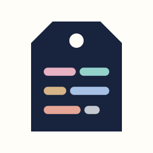
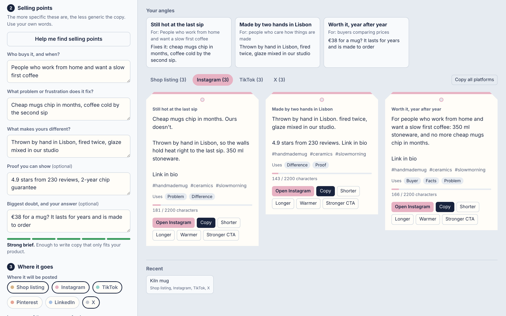

# Caption Studio

An Anna App that turns a seller's real selling points into conversion copy for their shop and social media, and checks every draft so it doesn't read like generic filler.

Built for the [Anna AI App Builder Program](https://dorahacks.io/hackathon/2349/detail) on DoraHacks.



## The problem

A one-line prompt like "write an Instagram caption for my ceramic mug" gives the same copy every shop gets: "Elevate your mornings with our handcrafted mug." It says nothing about why this mug is worth buying. Good copy is built on specifics the seller knows and the model doesn't: who buys it, what annoys them about the alternatives, what is really different, and what proof exists.

## What it is (and is not)

Caption Studio is a copywriting tool, not a campaign generator. It does one job: write the words for a product post or listing that could only be about this product and that sound like this seller. Its value is in the parts a plain chat prompt doesn't give you: structured selling points, different angles, checks in code, per-product memory, the seller's own voice from a swipe file, and in-place editing by chat.

## How Caption Studio works

1. **Product.** Type it in or start from a photo; the vision model fills in what it can see.
2. **Selling points.** Structured fields for the buyer and moment, the problem it fixes, what makes it different, proof, and the main doubt with the seller's answer. "Help me find selling points" asks 3–4 questions specific to the product to draw these out. A brief-strength meter shows what to add next.
3. **Angles.** The model first proposes 2–4 clearly different angles, each with a buyer, a promise and a hook, built only on the brief.
4. **Copy.** For each platform it writes one variant per angle and reports which selling points each text uses, quoting the phrase that carries it.
5. **Quality check, in code.** Every variant is checked for clichés, for numbers that are not in the brief (invented review counts, prices, percentages), for ignoring the selling points and for being in the wrong language. Failing drafts are redrafted once with specific feedback. The selling points a variant really uses are shown as chips; a number that still isn't in the brief is flagged on the variant.

## Features

- **Six platforms.** Shop listing, Instagram, TikTok, Pinterest, LinkedIn and X, each with its own format, hashtag count and live length check.
- **Brand voices.** Tone, audience, words to avoid and emoji style, saved per user.
- **One-click rewrites.** Shorter, longer, warmer or a stronger call to action. Shorter and Longer are verified in code to move in the right direction and stop at sensible limits.
- **Share.** Pre-filled posts for X and LinkedIn; copy-and-open for Instagram, TikTok and Pinterest; "Copy all platforms".
- **Start from a photo.** Resized in the browser and read with the host's vision model.
- **Five interface languages** (English, German, Chinese, Russian, Hindi) and **14 copy languages**. The copy always follows the selected copy language, also when the brief or the photo is in another language: every prompt names the output language at the top, and the result is checked in code (script and common words). Angles, variants and rewrites in the wrong language are redone once, then translated; nothing in the wrong language is shown.
- **Ask Caption Studio (chat edits).** Below the copy, ask for any change in your own words: "make the first text 30% shorter", "sound more authoritative", "change the hook for LinkedIn". The request goes to one Anna agent session per generation, together with the current copy, so the AI edits what you see and remembers the conversation. Each change is checked in code (platform limit, copy language, invented numbers) before it is applied; changed texts are highlighted and the latest change can be undone.
- **Product manager.** One place to manage every product: facts, target audience, unique selling points, proof, the main doubt, call to action and a **swipe file** of your best past posts. The swipe file teaches the copy your voice, rhythm and framing; it is never copied, and numbers from it are flagged like any other number not in the brief.
- **My products.** Every product you write copy for is saved automatically. Switching products in the brief loads its details and its latest copy (or an empty page for a new product).
- **Generation history.** The last 20 generations are kept with their copy, angles, platforms and time, filtered to the product you picked. Opening one shows the copy again without a model call, so it costs no tokens.
- **Light and dark mode.**

## How AI is used

Generation goes through `anna.llm.complete`: one call for the angles, one per platform for the copy (two in parallel), one optional call for the selling-point questions, one for a photo, and one per rewrite.

Chat edits use `anna.agent.session` (submode `auto`, a system prompt with the editing rules and a JSON answer format, no tools). One session belongs to one generation; its id is saved with the generation, so reopening it from the history attaches and refreshes the same session instead of starting over. Every message carries the brief and the current copy, so rewrites made with the buttons are never lost. All terminal states are handled: streamed text, `task_cancelled` (the Stop button calls `cancel`), error frames, empty answers (retried once) and expired sessions (replaced once). If no agent session is available, the same request goes to `anna.llm.complete` with the recent turns. Model output is strict JSON and is validated before it is shown. Brand voices, product profiles with their swipe files, the last brief and the history (with each generation's chat) are stored per user with `anna.storage`.

## Project layout

| Path | What |
|---|---|
| `app.json` | Store listing (name, tagline, description, category) |
| `manifest.json` | Schema 4 manifest: static SPA bundle (host APIs need no declaration in schema 4) |
| `bundle/index.html` | UI |
| `bundle/style.css` | Styles, light and dark |
| `bundle/app.js` | App logic, prompts, storage, photo input |
| `bundle/i18n.js` | Interface texts in English, German, Chinese, Russian and Hindi |
| `bundle/icon.svg`, `logo.svg` | Window icon and store logo (source) |
| `docs/logo-256.png`, `logo-512.png`, `logo-1024.png` | Store logo as PNG (`logo_file` in app.json) |
| `docs/screenshots/` | Store screenshots (`screenshots` in app.json, uploaded by `anna-app publish`) |
| `fixtures/happy-path.jsonl` | One canned answer that serves every step, for offline testing |

No backend and no Executa: everything runs in the Anna iframe.

## Run locally

```bash
npm install
npm run validate          # schema + permission checks
npm run dev:mock          # local harness with a canned AI answer, no account needed
anna-app login --host https://anna.partners
npm run dev               # local harness against the real Anna model
```

The harness opens at http://localhost:5180/.

Opening `bundle/index.html` from a plain web server also works: the app detects that it is not inside Anna and shows sample copy.

## Publish

```bash
anna-app login --host https://anna.partners
npm run publish
```

Then submit the version for review in the Anna developer console.

## License

MIT
