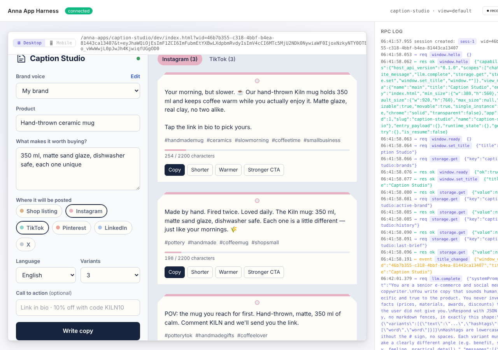

# Caption Studio

An Anna App that writes product descriptions, social media captions and hashtags in your brand's voice.

Built for the [Anna AI App Builder Program](https://dorahacks.io/hackathon/2349/detail) on DoraHacks.



## What it does

Small sellers write the same kind of copy every day: a shop listing, then an Instagram caption, then a TikTok caption, then a pin. Caption Studio turns one product brief into all of them.

- **Brand voices.** Save how your brand sounds, who buys, words to avoid and emoji style. Every text uses it. Switch between several brands.
- **Six platforms.** Shop listing, Instagram, TikTok, Pinterest, LinkedIn and X, each with its own length, structure and hashtag count.
- **Several angles per platform.** Benefit, story, feeling, practical detail.
- **Length check.** Each variant shows its length against the platform limit and turns red when it is too long.
- **One-click rewrites.** Shorter, warmer, or a stronger call to action, per variant.
- **12 output languages.** Defaults to the user's browser language.
- **History.** The last 12 results are saved and can be reopened.
- **No invented facts.** The prompt forbids inventing prices, materials, awards or discounts the user did not give.

## How AI is used

The app calls the host LLM with `anna.llm.complete`. Each platform gets its own request with a platform-specific format guide and the brand voice, and the model answers in strict JSON (`{"variants":[{"text","hashtags"}]}`) that the UI renders and validates. Rewrites send the chosen variant back with a single instruction. Brand voices, the last brief and history are stored per user with `anna.storage`.

## Project layout

| Path | What |
|---|---|
| `app.json` | Store listing (name, tagline, description, category) |
| `manifest.json` | Schema 3 manifest: static SPA bundle, `llm.complete`, `storage.get/set`, `chat.write_message`, `window.set_title` |
| `bundle/index.html` | UI |
| `bundle/style.css` | Styles, light and dark |
| `bundle/app.js` | App logic, prompts, storage |
| `bundle/icon.svg`, `logo.svg` | Window icon and store logo |
| `fixtures/happy-path.jsonl` | Canned LLM answer for offline testing |

No backend and no Executa: everything runs in the Anna iframe.

## Run locally

```bash
npm install
npm run validate          # schema + permission checks
npm run dev:mock          # local harness with a canned AI answer, no account needed
anna-app login --host https://anna.partners
npm run dev               # local harness against the real Anna model
```

The harness opens at http://localhost:5180/.

Opening `bundle/index.html` from a plain web server also works: the app detects that it is not inside Anna and shows sample copy.

## Publish

```bash
anna-app login --host https://anna.partners
npm run publish
```

Then submit the version for review in the Anna developer console.

## License

MIT
