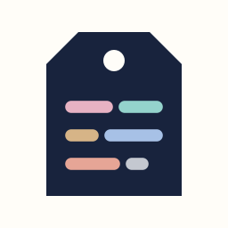
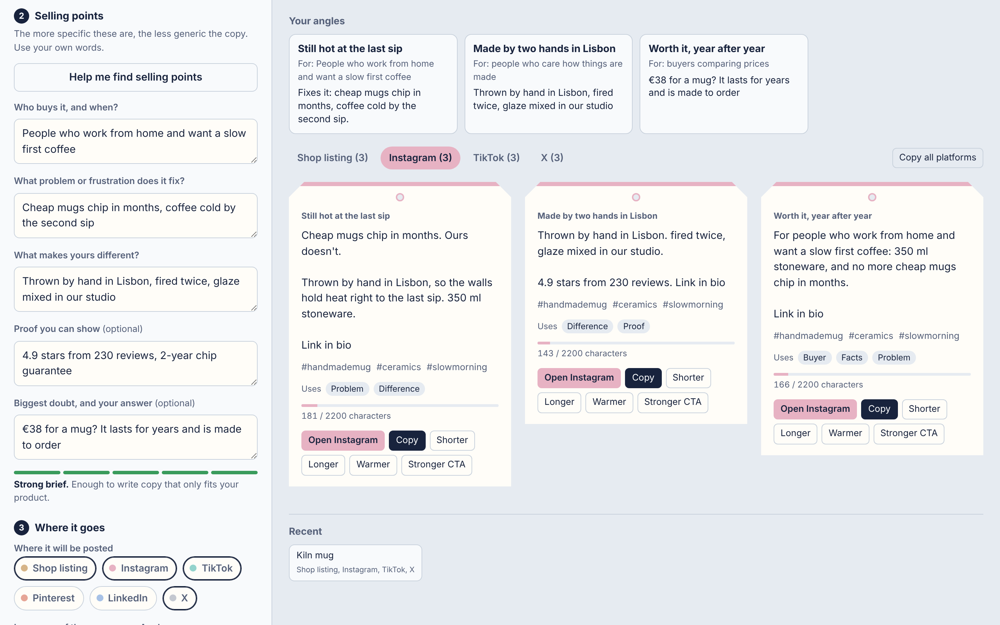

# Caption Studio

An Anna App that turns a seller's real selling points into conversion copy for their shop and social media, and checks every draft so it doesn't read like generic filler.

Built for the [Anna AI App Builder Program](https://dorahacks.io/hackathon/2349/detail) on DoraHacks.



## The problem

A one-line prompt like "write an Instagram caption for my ceramic mug" gives the same copy every shop gets: "Elevate your mornings with our handcrafted mug." It says nothing about why this mug is worth buying. Good copy is built on specifics the seller knows and the model doesn't: who buys it, what annoys them about the alternatives, what is really different, and what proof exists.

## How Caption Studio works

1. **Product.** Type it in or start from a photo; the vision model fills in what it can see.
2. **Selling points.** Structured fields for the buyer and moment, the problem it fixes, what makes it different, proof, and the main doubt with the seller's answer. "Help me find selling points" asks 3–4 questions specific to the product to draw these out. A brief-strength meter shows what to add next.
3. **Angles.** The model first proposes 2–4 clearly different angles, each with a buyer, a promise and a hook, built only on the brief.
4. **Copy.** For each platform it writes one variant per angle and reports which selling points each text uses, quoting the phrase that carries it.
5. **Quality check, in code.** Every variant is checked for clichés, for numbers that are not in the brief (invented review counts, prices, percentages) and for ignoring the selling points. Failing drafts are redrafted once with specific feedback. The selling points a variant really uses are shown as chips; a number that still isn't in the brief is flagged on the variant.

## Features

- **Six platforms.** Shop listing, Instagram, TikTok, Pinterest, LinkedIn and X, each with its own format, hashtag count and live length check.
- **Brand voices.** Tone, audience, words to avoid and emoji style, saved per user.
- **One-click rewrites.** Shorter, longer, warmer or a stronger call to action. Shorter and Longer are verified in code to move in the right direction and stop at sensible limits.
- **Share.** Pre-filled posts for X and LinkedIn; copy-and-open for Instagram, TikTok and Pinterest; "Copy all platforms".
- **Start from a photo.** Resized in the browser and read with the host's vision model.
- **Five interface languages** (English, German, Chinese, Russian, Hindi) and **14 copy languages**.
- **History, light and dark mode.**

## How AI is used

All calls go through `anna.llm.complete`: one call for the angles, one per platform for the copy (two in parallel), one optional call for the selling-point questions, one for a photo, and one per rewrite. Model output is strict JSON and is validated before it is shown. Brand voices, the last brief and the history are stored per user with `anna.storage`.

## Project layout

| Path | What |
|---|---|
| `app.json` | Store listing (name, tagline, description, category) |
| `manifest.json` | Schema 3 manifest: static SPA bundle, `llm.complete`, `storage.get/set`, `chat.write_message`, `window.set_title` |
| `bundle/index.html` | UI |
| `bundle/style.css` | Styles, light and dark |
| `bundle/app.js` | App logic, prompts, storage, photo input |
| `bundle/i18n.js` | Interface texts in English, German, Chinese, Russian and Hindi |
| `bundle/icon.svg`, `logo.svg` | Window icon and store logo (source) |
| `docs/logo-256.png`, `logo-512.png`, `logo-1024.png` | Store logo as PNG (`logo_file` in app.json) |
| `docs/screenshots/` | Store screenshots (`screenshots` in app.json, uploaded by `anna-app publish`) |
| `fixtures/happy-path.jsonl` | One canned answer that serves every step, for offline testing |

No backend and no Executa: everything runs in the Anna iframe.

## Run locally

```bash
npm install
npm run validate          # schema + permission checks
npm run dev:mock          # local harness with a canned AI answer, no account needed
anna-app login --host https://anna.partners
npm run dev               # local harness against the real Anna model
```

The harness opens at http://localhost:5180/.

Opening `bundle/index.html` from a plain web server also works: the app detects that it is not inside Anna and shows sample copy.

## Publish

```bash
anna-app login --host https://anna.partners
npm run publish
```

Then submit the version for review in the Anna developer console.

## License

MIT
